# Play Tactical Aggregates After Sell-off: DeMark 9 with stop and re-entry

This repo backtests a tactical long strategy on **developed-market equity indices and US sectors**:

1. Wait for a sell-off that completes a **DeMark TD buy setup 9**, on the **weekly** chart (main case) and on the **daily** chart.
2. Use the 9th candle as the trade's anchor:
   * **stop-loss** just below the candle's **low**
   * after a stop-out, **re-enter** when price trades back above the candle's **high**
   * each re-entry is **bigger** than the one before, and you get **up to 5 re-entries** (6 attempts in total)
3. Simulate everything, optimize the candle rules, and report the PnL.

Data runs from 1990-01 to 2026-11-03 (Yahoo Finance daily OHLC). The in-sample period is 1990–2012 and the out-of-sample period is 2013–2026.

---

## Weekly MACD as the only signal (no DeMark): MACD stop, 1-year exit, max 3 assets

Rules (`scripts/macd_only_study.py`, results in `results/macd_only/`):

* **Signal:** the weekly close where **both the MACD line (EMA12 − EMA26, "fast") and its signal line (EMA9 of MACD, "slow") are above 0** for the first time in a new up-phase. **Buy at the next open.**
* **Stop-loss:** the first weekly close with the **MACD line below 0**, exit at the next open. **Take-profit:** exit after **1 year** in the position.
* **Max 3 assets at once.** Each new position gets 1/3 of current equity, with compounding and no leverage; 3 bps per side. If several turn on in the same week, the strongest MACD (as % of price) goes first.
  * Asked version ("fresh only"): a signal that finds no free slot is lost.
  * "Queue" variant: an asset still in an untraded up-phase can take a slot later, freshest up-phase first. One trade per up-phase.

| Compounded, 1990-2026 | Trades | Win % | Avg trade | Exit after 1 year (avg) | Stopped by MACD < 0 (avg) | CAGR (in / out of sample) | Max DD | Sharpe | Invested |
|---|---|---|---|---|---|---|---|---|---|
| **MACD signal, max 3 (asked)** | 133 (3.6/yr) | 48 % | **+7.8 %** | 40 % (**+26.0 %**) | 59 % (**−4.4 %**) | **8.5 %** (7.4 / 10.3) | **−26 %** | **0.79** | 72 % |
| Queue: free slot to the freshest up-phase | 195 | 44 % | +5.9 % | 30 % (+27.9 %) | 70 % (−3.4 %) | 9.3 % (9.1 / 9.5) | −32 % | 0.69 | 90 % |
| Stop on the signal line < 0 instead | 116 | 55 % | +8.8 % | 50 % | 50 % (−5.9 %) | 8.1 % | −31 % | 0.75 | 72 % |
| MACD stop only, no 1-year exit | 90 | 46 % | +12.1 % | – | 100 % | 9.4 % | −33 % | 0.75 | 86 % |
| MACD stop, hold up to 2 years | 109 | 44 % | +10.9 % | 16 % (+57 %) | 84 % | 9.2 % | −29 % | 0.74 | 83 % |
| 1-year exit only, no stop | 89 | 76 % | +14.0 % | 100 % | – | 10.1 % (7.7 / 14.2) | −31 % | 0.86 | 79 % |
| Max 1 asset | 50 | 49 % | +9.0 % | 39 % | 61 % | 9.9 % | −35 % | 0.65 | 78 % |
| Max 5 assets | 204 | 48 % | +7.5 % | 39 % | 61 % | 7.6 % | −27 % | 0.78 | 67 % |
| *Equal-weight buy & hold, all 27* | – | – | – | – | – | **9.7 %** | −52 % | 0.68 | 100 % |
| *S&P 500 buy & hold (price)* | – | – | – | – | – | 8.6 % | −57 % | 0.55 | 100 % |

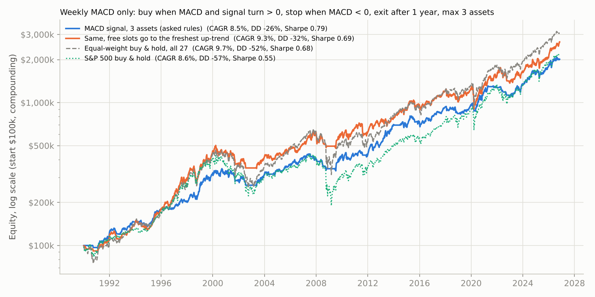

**What to take from it**

1. **This is the best risk-adjusted design in the project.** With the asked rules you get about the S&P 500's return (8.5 % vs 8.6 % CAGR) with **half the drawdown** (−26 % vs −57 %) and a higher Sharpe (0.79 vs 0.55; 0.68 for equal-weight buy & hold). It holds up out-of-sample: 10.3 % CAGR from 2013 to 2026.
2. **It is a classic trend-following payoff.** Most trades lose a little: 59 % are stopped at about −4 %, and the worst trade is only −12.8 %. The 40 % that survive the year make about +26 %. Best trades: Nasdaq 100 1998 (+79 %), Nikkei 2013 (+63 %), Nasdaq and XLK after COVID (+58 %).
3. **The MACD stop is what keeps the drawdown small.** It cut the 2001-02 and 2008 bear markets short: the worst years were −15 % (2022), −15 % (2001) and −14 % (2008), while buy & hold fell about −50 %. Dropping the stop and only exiting after 1 year gives a higher Sharpe (0.86) and 10.1 % CAGR, but single trades can lose −37 % and the result leans on 2013-2026. That makes it riskier than it looks.
4. **Three assets at once is about right.** One asset is too concentrated (−35 % DD). Five is safer (−27 %) but earns less (7.6 %). The queue variant (always keeping 3 slots full) earns 9.3 % but with a deeper −32 % drawdown.
5. **What to use:** the asked rules as they are, or with the slower signal-line stop (8.1 %, Sharpe 0.75). Don't tune further: every variant lands between 7.6 % and 10 % CAGR. Most of the profit came from tech and Japan (XLK, Nasdaq 100, Nikkei); the losers were AEX, ASX 200 and Health Care.

**Live under the asked rules** (latest close 2026-11-03), all 3 slots full:

| Asset | Up-phase started | Entered | Entry | Last close | Open P&L | 1-year exit |
|---|---|---|---|---|---|---|
| XLB Materials | 2025-12-12 | 2025-12-15 | 44.61 | 52.59 | +17.8 % | 2026-12-15 |
| Nasdaq 100 | 2026-04-10 | 2026-04-13 | 25,069 | 28,180 | +12.3 % | 2027-04-13 |
| DAX | 2026-05-08 | 2026-05-11 | 24,333 | 25,865 | +6.2 % | 2027-05-11 |

* **Weekly MACD and signal are both above 0 now (19 assets):** S&P 500, Nasdaq 100, Dow, Russell 2000, TSX, Euro Stoxx 50, DAX, FTSE 100, AEX, IBEX, SMI, FTSE MIB, Nikkei, and the sectors XLK, XLF, XLE, XLV, XLP, XLB.
* **Not on (8 assets):** CAC 40, ASX 200, Hang Seng, XLI, XLY, XLU, XLRE, XLC.

These are backtest model states, not investment advice.

Reproduce: `python scripts/macd_only_study.py && python scripts/macd_only_charts.py`.

---

## Weekly-MACD strategy: 1 % stop with re-entry, 1 % ladder / martingale, take-profit grid

These tests start from the MACD-only strategy above: a new up-phase signal, the MACD < 0 stop, max 3 assets with 1/3 of equity each, and compounding. Scripts: `scripts/macd_variants_study.py` and `strategy/macd_engine.py`; results in `results/macd_variants/`.

* **1 % stop + re-entry at the first entry point:** stop 1 % below the first entry price E0. After a stop-out, re-enter on a buy-stop at E0, any number of times while the MACD trend lasts. The size is the same each time. 2 %, 3 % and 5 % stops were also tested.
* **1 % ladder / martingale:** buy more every 1 % below E0. Martingale sizes are 1, 2, 4, 8, 16, 32 (5 steps); flat sizes are 1 unit per step (10 steps). The full ladder is sized to the slot's 1/3 of equity, so there is no leverage. The only stop is MACD < 0, as usual.
* **Take-profit grid:** time of 3 months / 6 months / 1 year / 2 years / none × level of +5 / +10 / +20 / +30 % / none. The level is measured from E0, or from the average cost for the ladder.

| Take-profit 1 year, no level | Campaigns | Win % | Avg campaign | Stop-outs per campaign | CAGR (in / out of sample) | Max DD | Sharpe | Invested |
|---|---|---|---|---|---|---|---|---|
| **Base (no price stop)** | 133 | 48 % | +7.8 % | – | **8.5 %** (7.4 / 10.3) | **−26 %** | **0.79** | 69 % |
| 1 % stop, re-entry at E0 | 133 | 43 % | +7.0 % | 2.9 (max 14) | 7.7 % (6.8 / 9.2) | −28 % | 0.77 | 63 % |
| 2 % / 3 % / 5 % stop, re-entry at E0 | 133 | 43-45 % | +6.8 to +7.3 % | 1.7 / 1.1 / 0.5 | 7.3 / 7.5 / 8.0 % | −30 to −33 % | 0.73-0.76 | 65-67 % |
| Martingale ladder ×2, 1 % step, 5 steps | 133 | 62 % | +1.9 % | – | 2.1 % | −19 % | 0.43 | 19 % |
| Martingale ladder ×2, 7 steps | 133 | 67 % | +1.0 % | – | 1.2 % | −16 % | 0.32 | 11 % |
| Flat ladder, 1 % step, 10 steps | 133 | 56 % | +2.3 % | – | 2.6 % | −13 % | 0.55 | 22 % |

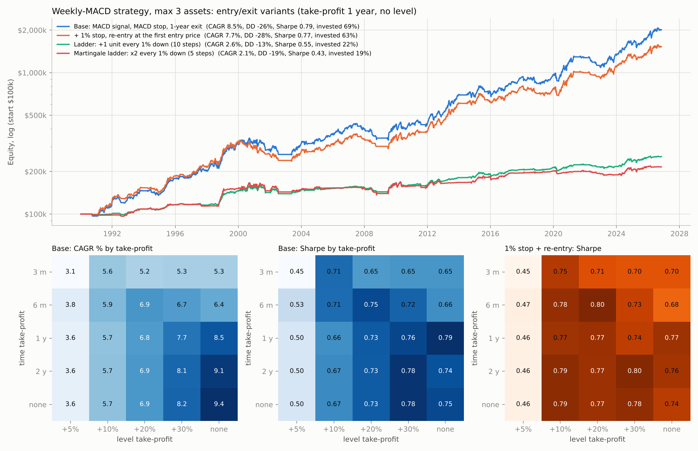

**What to take from it**

1. **The 1 % stop with re-entry doesn't help.** In a weekly uptrend a 1 % stop is just daily noise. You get stopped about 3 times per campaign (up to 14 times: XLI 2023, CAC 2025-26) and buy back at the same price. That costs about 0.8 %/yr of CAGR with no drawdown benefit (−28 % vs −26 %). Wider stops move steadily back toward the base result (5 % stop: 8.0 %), which shows the extra stop has no edge.
2. **The ladder / martingale doesn't help either.** With no leverage it leaves most of the money idle: 11-22 % invested on average, versus 69 % for the base. Return per unit invested is about the same (11-12 % vs 12.2 %), so buying lower adds nothing. The ×2 martingale has the worst Sharpe (0.32-0.43): its biggest buys land in the pullbacks that turn into the MACD < 0 exit. Levering it up to the base's exposure would give a worse result than the base.
3. **Take-profit:**
   * **Time:** longer means more return but a deeper drawdown. No time exit gives 9.4 % CAGR at −33 %; 2 years gives 9.1 % at −29 %. **1 year is the Sharpe sweet spot (0.79).**
   * **Level:** a tight target kills the edge, because the winners are what pay for the many small MACD stop losses. +5 % gives 3.6 % CAGR and Sharpe 0.50; +10 % gives 5.7 %. +30 % is about neutral. **No level target is best.**
   * Lowest drawdown with a decent Sharpe: 6 months / +20 % gives 6.9 % CAGR, −22 % DD, Sharpe 0.75.
   * The top Sharpe cells for the 1 % stop variant (0.80 at 6 m / +20 % and 2 y / +30 %) only tie the base, and the first one is unstable: 4.2 % in-sample vs 9.6 % out-of-sample.
4. **Bottom line:** keep the plain rules. Buy the new MACD up-phase, use no price stop, exit when MACD < 0 or after 1 year, with no level target. If you want a smaller drawdown, use 6 months / +20 % and accept about 1.6 %/yr less return. Neither the 1 % stop nor the martingale ladder improves anything.

Reproduce: `python scripts/macd_variants_study.py && python scripts/macd_variants_charts.py`.

---

## Short leg on the WORST weekly-MACD profile (27 DM indices + US sectors)

Scripts: `scripts/worst_short_study.py` and `scripts/worst_short_charts.py`; results in `results/worst_short/`.

**How "worst MACD profile" is measured.** A raw MACD isn't comparable across assets, because it is in index points. So each week every asset gets four candidate scores; lower = worse:

| Score | Formula | What a very negative value means |
|---|---|---|
| depth | MACD / price | the 12-week average is far below the 26-week average, i.e. a deep downtrend |
| depth_vol | MACD / (price × 26-week volatility) | the same depth measured in the asset's own weekly swings, so quiet utilities and volatile Hang Seng compare fairly |
| accel | (MACD − signal) / price | negative histogram: the downtrend is **still accelerating** |
| **composite** | average cross-sectional rank of depth_vol and accel_vol | **deep in σ terms AND still getting worse.** This is the "worst profile" chosen in-sample (1990-2012) |

**Short leg rules:**
* Each week, short the **3 worst** assets that are also in a downtrend (MACD and signal below 0), at the next open.
* Cover when MACD turns above 0, when the asset leaves the worst 6, or after 1 year.
* 1/3 of equity per short, no leverage.

| 1990-2026 | Trades | Win % | Avg trade | CAGR (in / out of sample) | Max DD | Sharpe |
|---|---|---|---|---|---|---|
| **Short the 3 worst — composite (chosen)** | 337 | 34 % | −1.1 % | **−3.9 %** (−1.1 / −8.4) | **−83 %** | −0.21 |
| Short the 3 worst — depth / depth_vol / accel | 213-299 | 28-32 % | −1.5 to −2.1 % | −4.8 to −5.1 % | −86 to −88 % | −0.26 to −0.30 |
| Short only the single worst / the 5 worst | 161 / 389 | 39 / 33 % | | −4.8 / −3.9 % | −88 / −81 % | −0.14 / −0.25 |
| *Long the 3 best profiles (mirror image, depth_vol)* | 269 | 55 % | +4.4 % | 9.4 % (8.6 / 10.6) | −40 % | 0.68 |
| *Contrarian: BUY the 3 worst profiles, sell when MACD > 0* | 214-340 | **66-72 %** | +1.0 to +2.0 % | 2.2-3.0 % | −61 to −72 % | 0.21-0.26 |
| *Long: new MACD up-phase, max 3 (earlier rules)* | 125 | 48 % | +7.8 % | **8.4 %** | **−24 %** | **0.80** |
| Earlier long + 50 % worst-short overlay | – | – | – | 6.8 % | −21.5 % | 0.64 |
| Earlier long + 100 % worst-short overlay | – | – | – | 4.6 % | −34.5 % | 0.37 |
| 50 / 50 earlier long + worst short | – | – | – | 2.6 % | −17.7 % | 0.37 |
| *Equal-weight buy & hold of the 27* | – | – | – | 9.7 % | −52 % | 0.68 |

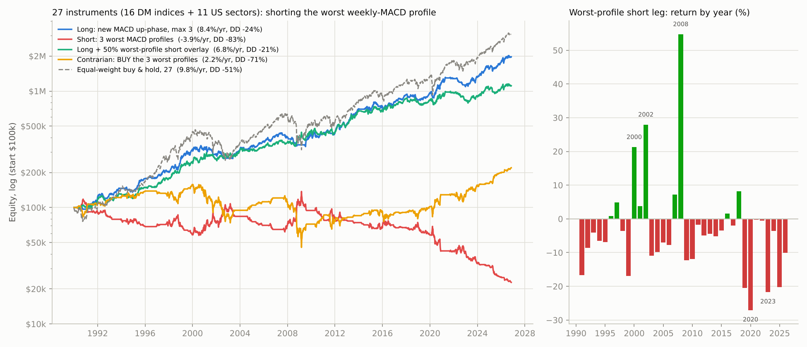

**What to take from it (and what "worst MACD profile" means)**

1. **The worst profile is a stretched, still-falling market, and those usually bounce.** An asset that is deep below its 26-week trend and still accelerating down is *oversold*. Buying the 3 worst profiles wins **66-72 %** of the time. Shorting them therefore loses: −4 to −5 %/yr, with a −83 % to −88 % drawdown. That is the same mean-reversion this project started from (DeMark 9 after a sell-off).
2. **The short leg is crash insurance, not an alpha source.** It made money in only 9 of 36 years, but those are the crashes: **+55 % in 2008, +28 % in 2002, +21 % in 2000, +8 % in 2018**. It loses steadily in normal years and gets hit hardest in V-shaped rebounds: −27 % in 2020, −22 % in 2023, −20 % in 2019 and 2025.
3. **As an overlay it costs more than it saves.** Adding a 50 % worst-profile short to the long strategy lowers the max drawdown only from −24 % to −21.5 %, but cuts CAGR from 8.4 % to 6.8 % and Sharpe from 0.80 to 0.64. A full-size overlay is worse. The long leg's own MACD < 0 exit already takes you to cash in bear markets, which is cheaper protection.
4. **Use the MACD profile the other way round.** The *best* profile (highest depth_vol) is a decent long rotation: 9.4 %/yr, Sharpe 0.68, −40 % DD. The earlier rule (buy a new up-phase) is still the best long: Sharpe 0.80, −24 % DD.
5. **If you still want a short leg:** keep it small and use it only in a market-wide downtrend (e.g. when most of the 27 have MACD < 0). It only pays when the whole market is falling, not when one sector is.

**Worst MACD profiles right now** (week ending 2026-10-30; composite rank, 1 = worst):

| Rank | Asset | MACD % of price | MACD in σ | Histogram % | Downtrend (both lines < 0) | Reading |
|---|---|---|---|---|---|---|
| 1 | XLI Industrials | −0.62 % | −0.40 | −1.16 % | no (signal still > 0) | fresh roll-over, falling fast but not yet a confirmed downtrend |
| 2 | **CAC 40** | −1.14 % | −0.74 | −0.80 % | **yes** | the worst *confirmed* downtrend, still accelerating. **Short held since 2026-10-26 (−2.6 %)** |
| 4 | XLC Communication Services | −1.54 % | −0.68 | −0.83 % | yes | deep and accelerating; just outside the worst 3 |
| 4 | FTSE MIB / Russell 2000 | +0.59 % / +0.17 % | +0.33 / +0.09 | −1.33 % / −1.27 % | no | still in up-trends, but momentum fading fast |
| 6 | Hang Seng | −1.85 % | −0.76 | −0.75 % | yes | the deepest downtrend in σ terms |
| 12 | XLU Utilities | −1.34 % | −0.57 | +0.04 % | yes | deep but already stabilising (histogram turned up) |

These are backtest model states, not investment advice.

Reproduce: `python scripts/worst_short_study.py && python scripts/worst_short_charts.py`.

---

## US stocks without survivorship bias: point-in-time S&P 500 membership

Scripts: `scripts/sp500_pit_data.py`, `scripts/sp500_pit_fix.py` and `scripts/sp500_pit_study.py`; results in `results/sp500_pit/`.

* **Membership:** daily S&P 500 constituents since 1996 from [fja05680/sp500](https://github.com/fja05680/sp500), based on Andreas Clenow's list. 1,209 tickers have ever been members.
* **Size ranking:** each month the **100 largest members by trailing 1-year average dollar volume** form the tradable list. Historical market caps aren't freely available, so dollar volume stands in for size. A MACD signal counts only if the stock is on that month's list.
* **Same rules as before:** MACD < 0 stop, 1-year exit, 1/N of equity per position, cash-capped. A stock whose price history ends mid-trade (delisted or acquired) is closed at its last price.
* **Remaining bias:** Yahoo only keeps listed stocks. With renames mapped (FB→META, ANTM→ELV, UTX→RTX, BK→BNY, MMC→MRSH, …), 785 of 1,209 tickers have data. Member coverage is 38 % in 1996, 47 % in 2000, 61 % in 2008, 74 % in 2015 and 98 % in 2026. The missing names are mostly bankruptcies and takeovers (Lehman, WorldCom, Enron, Bear Stearns, Wachovia, Time Warner, …), so these results are **still somewhat too optimistic**, especially before 2010. Fully clean data needs a paid source (Norgate, CRSP, EOD Data).

| 1997-2026, compounded | **Point-in-time top 100**: CAGR | Max DD | Sharpe | *Today's top 100 (biased)*: CAGR | Max DD |
|---|---|---|---|---|---|
| MACD signal, max 3 (asked rules) | **8.7 %** (IS 7.4 / OOS 9.9) | −54 % | 0.47 | *20.8 %* | *−75 %* |
| MACD signal, max 10 | 6.8 % | −46 % | 0.47 | *19.3 %* | *−53 %* |
| MACD signal, max 20 | 8.3 % | −43 % | 0.59 | *18.2 %* | *−41 %* |
| 1 % stop + re-entry, max 3 | 9.1 % | −46 % | 0.53 | *24.5 %* | *−51 %* |
| 1 % stop + re-entry, max 10 | 6.8 % | −45 % | 0.53 | *20.8 %* | *−39 %* |
| **1 % stop + re-entry, max 20** | 8.0 % | **−36 %** | **0.67** | – | – |
| Pyramid up 1 %, 5 adds, max 3 / max 10 | 8.2 % / 6.5 % | −51 % / −43 % | 0.47 | – | – |
| Martingale ladder ×2, max 3 / max 10 | 3.9 % / 3.1 % | −42 % / −35 % | 0.30 | – | – |
| Max 3, random pick among same-day signals (20 draws) | 5.0 % (2.0-10.1) | −63 % | 0.33 | – | – |
| *Equal-weight buy & hold of the point-in-time top 100* | **12.8 %** | −58 % | **0.67** | *20.3 % (today's 100)* | *−47 %* |
| *S&P 500 total return* | **10.1 %** | −55 % | 0.60 | | |

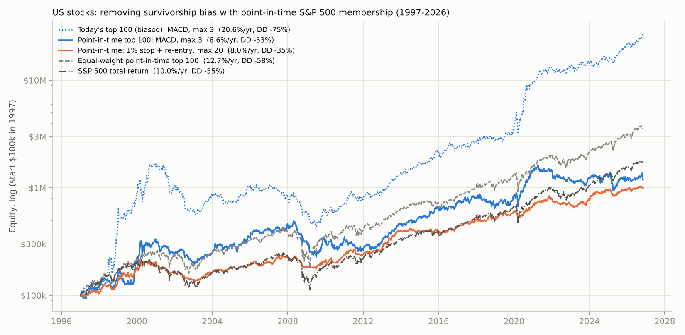

**What to take from it**

1. **Survivorship bias explained almost all of the earlier stock result.** Picking from stocks that were really in the S&P 500 at the time, the 3-stock MACD strategy drops from **20.8 % to 8.7 %/yr** over the same 1997-2026 window. Even that is still flattered by the missing bankruptcies.
2. **On US large caps the MACD strategy does not beat buy & hold.** It made 7-9 %/yr, against 10.1 % for the S&P 500 and 12.8 % for an equal-weight top 100. The 3-stock version is also luck-dependent: a random pick among same-day signals gives 2-10 %/yr.
3. **The only redeeming setup is 20 stocks with the 1 % stop + re-entry.** It makes 8.0 %/yr with a **−36 %** max drawdown (vs −55 % for the S&P 500) and Sharpe 0.67, about the same as the equal-weight index. That is a risk-reduction tool, not an alpha source.
4. **Ladder / martingale remains the worst** (3-4 %/yr), and pyramiding is neutral. Same as on indices.
5. **Practical conclusion:** the weekly-MACD idea works better on diversified indices and sectors (8.4 %/yr, −24 % DD, Sharpe 0.80) than on single stocks. On stocks it mostly cuts the drawdown and gives up return.

---

## Short leg: shorting DM indices when the weekly MACD turns below zero

Scripts: `scripts/macd_short_study.py`, chart `scripts/pit_short_charts.py`; results in `results/macd_short/`. This mirrors the long strategy on the 16 DM indices:

* **Short** at the next open when the weekly MACD and signal both turn below 0.
* **Cover** when the weekly MACD goes back above 0, or after 1 year. Tested with and without a **1 % stop above the entry plus re-entry**: re-short when price falls back to the entry.
* **Max 3 shorts**, 1/3 of equity each.
* Shorts are simulated with the long engine on prices mirrored around the entry. This is exact per unit and cross-checked against hand calculations. Index futures carry is not modelled.

| 1990-2026, 16 DM indices, max 3 | Trades | Win % | CAGR (in / out of sample) | Max DD | Sharpe |
|---|---|---|---|---|---|
| **Short leg, MACD stop, 1 year** | 135 | 23 % | **−3.2 %** (−0.8 / −7.1) | **−76 %** | −0.24 |
| Short leg + 1 % stop & re-entry | 135 | 17 % | −0.4 % (+1.4 / −3.3) | −51 % | 0.00 |
| Short + 1 % stop & re-entry, target −20 %, 1 year (best cell) | 147 | 23 % | +0.5 % (+2.5 / −2.7) | −42 % | 0.10 |
| Short leg on all 27 (indices + sectors) | 156 | 24 % | −2.9 % | −72 % | −0.18 |
| *Long leg, same 16 DM indices, MACD stop* | 125 | 46 % | **6.9 %** | −23 % | 0.71 |
| *Long leg + 1 % stop & re-entry* | 125 | 41 % | 6.9 % | −20 % | **0.76** |
| 50 / 50 long + short (both with 1 % stop) | – | – | 3.4 % | −15 % | 0.59 |
| Long 100 % + short overlay 100 % (both with 1 % stop) | – | – | 6.6 % | −29 % | 0.59 |
| *Equal-weight DM indices buy & hold* | – | – | 8.6 % | −55 % | 0.61 |

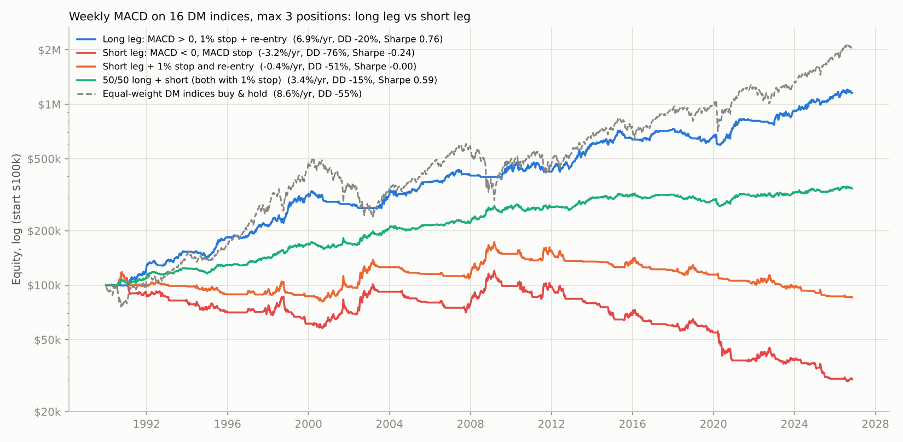

**What to take from it**

1. **The short leg loses money over time.** It does pay in real bear markets: +30 % in 2002, +41 % in 2008, +6-8 % in 2000-01 and 2011. But most MACD < 0 phases are just corrections inside a rising market. 89 % of shorts are stopped by the MACD turning back up, at about −5 % each.
2. **Rebounds are brutal for a slow weekly signal.** The worst shorts were opened right at the lows: Russell 2000 at the March 2020 bottom lost −47 %, and FTSE 100 in March 2020 lost −22 %. 2020 alone cost the short book −30 %.
3. **The 1 % stop & re-entry halves the damage** (−0.4 %/yr instead of −3.2 %, DD −51 % instead of −76 %) **but does not make it profitable.** Out-of-sample (2013-2026) every short variant lost money.
4. **Adding the short leg makes the long strategy worse.** The legs are negatively correlated (−0.16 to −0.25). 50/50 cuts the drawdown to −15 % but also cuts return to 3.4 % (Sharpe 0.59 vs 0.76 long-only). Long + short overlay is 6.6 %/yr with Sharpe 0.59.
5. **If you want downside protection,** the long leg's own MACD exit already moves you to cash in bear markets. A short leg on a slow weekly signal is not worth carrying. If anything, use it only as a small hedge with the 1 % stop.

**Short book live now (2026-11-03):**
* Short **Hang Seng** since 2026-06-22: +1.2 %, or −0.9 % with the 1 % stop after 2 stop-outs.
* Short **CAC 40** since 2026-10-26: −2.6 %; with the 1 % stop it is flat, waiting to re-short at the entry.
* These are the only two DM indices with both weekly MACD lines below 0. These are backtest model states, not investment advice.

---

## The same MACD tests on the 100 biggest US stocks

Universe (`scripts/us100_universe.py`): today's 100 largest S&P 500 companies by market cap (Yahoo Finance, Nov 2026), one share class each, from Apple ($5.1tn) to #100 at $123bn. Daily data is dividend- and split-adjusted, from 1990 or the listing date. Rules are the same as the index study: buy at the next open when the weekly MACD and signal both turn > 0, exit on MACD < 0 or after 1 year, 1/N of equity per position, no leverage. Script: `scripts/us100_study.py`; results in `results/us100/`.

> **Big caveat: survivorship bias.** These are *today's* winners: Nvidia, Tesla, Vertex, Palantir and so on. Any backtest on them back to 1990 looks great, so the fair yardstick is **buy & hold of the same 100 stocks**, which has the same bias.

| 1990-2026, compounded | Positions | CAGR (in / out of sample) | Max DD | Sharpe | Invested |
|---|---|---|---|---|---|
| **MACD signal, max 3 stocks (asked rules)** | 201 | **21.3 %** (17.7 / 27.6) | **−75 %** | 0.85 | 91 % |
| MACD signal, max 5 | 325 | 19.9 % | −61 % | 0.91 | 91 % |
| MACD signal, max 10 | 607 | 20.7 % (23.3 / 16.2) | −53 % | 1.07 | 89 % |
| MACD signal, max 20 | 1,131 | 19.3 % (19.8 / 18.3) | −41 % | 1.15 | 85 % |
| **+ 1 % stop, re-entry at first entry, max 3** | 201 | **24.5 %** (23.7 / 25.7) | −51 % | 1.02 | 76 % |
| **+ 1 % stop, re-entry at first entry, max 10** | 608 | 22.1 % (25.5 / 16.4) | **−39 %** | **1.25** | 77 % |
| Pyramid up, 1 % step, 5 adds, max 3 / max 10 | 201 / 608 | 21.6 % / 19.9 % | −61 % / −50 % | 0.89 / 1.08 | 83 % / 81 % |
| Martingale ladder ×2, 1 % step, max 3 / max 10 | 201 / 616 | 13.5 % / 12.7 % | −72 % / −46 % | 0.69 / 0.87 | 50 % |
| Same rules, max 3, random pick among same-day signals (30 draws) | – | 16.0 % (10.6-24.1) | −62 % (−50 to −73) | 0.75 (0.55-1.03) | – |
| *Equal-weight buy & hold of the same 100 stocks* | – | **22.0 %** (21.4 / 22.7) | **−47 %** | **1.13** | 100 % |
| *S&P 500 total return* | – | 10.8 % | −55 % | 0.66 | 100 % |

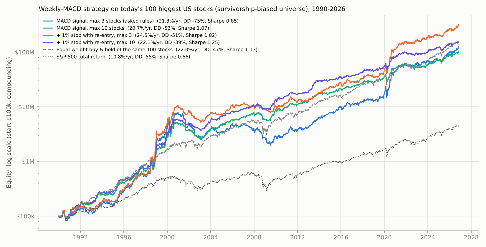

**What to take from it**

1. **The 20 %+ returns come from the stock list, not the signal.** Just holding the same 100 stocks made 22 %/yr with Sharpe 1.13. The asked rules (max 3) made 21 %/yr with a **−75 % drawdown**: 2000-02 wiped out three quarters of the account, and the drawdown from the Nov 2000 peak bottomed only in July 2009. Against the right yardstick the plain MACD strategy adds nothing.
2. **The weekly MACD is too slow for single stocks.** Individual stocks crash far faster than indices. Trades lost **−53 %** (Intuitive Surgical 2001), −41 % (Capital One 2002), −36 % (Nvidia 2001) and −32 % (Gilead 2000) before the weekly MACD turned negative. With only 3 positions, a few of those sink the account.
3. **Which 3 stocks you hold is mostly luck.** Picking randomly among same-day signals gives anywhere from 10.6 % to 24.1 %/yr (mean 16 %). The 21 % comes largely from a few giant winners: Vertex +391 % in 1999-2000, Tesla, Amphenol, Merck. The take-profit grid is noisy for the same reason.
4. **On stocks the 1 % stop with re-entry *does* help, unlike on indices.** It cuts the crashing stocks early and re-buys if they recover:
   * Max 3: 24.5 %/yr with DD −51 % instead of −75 %.
   * Max 10: 22.1 %/yr, **DD −39 %, Sharpe 1.25**. This is the only setup that beats buy & hold of the same stocks on risk (−39 % vs −47 %, Sharpe 1.25 vs 1.13).
   * Caveat: the max 10 version earned only 16.4 %/yr in 2013-2026, versus 22.7 % for buy & hold.
5. **More positions are safer:** 3 → 10 → 20 stocks moves the drawdown from −75 % → −53 % → −41 % at about the same return. Pyramiding is about neutral, as on indices. The martingale ladder is clearly worse (12-14 %/yr).
6. **What to use on stocks:** hold **10-20 names**, not 3. **Add the 1 % stop with re-entry at the first entry price.** Judge it against buy & hold of the same list, not against the S&P 500. To remove the survivorship bias you would need point-in-time index membership (e.g. a paid S&P constituents history).

**Live (asked rules, max 3, 2026-11-03):** Merck (+50 % since 2025-11-24), Eli Lilly (+41 % since 2026-05-18), Visa (+18 % since 2026-07-20). 66 of the 100 stocks have both weekly MACD lines above 0 right now. These are backtest model states, not investment advice.

*Sizing note:* this study caps each new position at the cash not tied up in open positions, so there is no hidden leverage. The same fix applied to the index study changes it only marginally: base 8.5 % → 8.4 %/yr, DD −25.5 % → −24.2 %, Sharpe 0.79 → 0.80.

Reproduce: `python scripts/us100_universe.py && python scripts/us100_data.py && python scripts/us100_study.py && python scripts/us100_charts.py`.

---

## Weekly-MACD strategy: pyramiding up (1 unit, +1 unit every 1 % up)

Same signal, MACD < 0 stop, 3 slots and compounding as above (`scripts/macd_pyramid_study.py`, results in `results/macd_pyramid/`).
* Start with **1 unit** at the first entry E0.
* Add **+1 unit on a buy-stop every 1 % above E0** (E0 × 1.01, × 1.01², …), up to K adds.
* The K+1 units together equal the slot's 1/3 of equity, so there is no leverage.
* Everything is closed on MACD < 0 or at the take-profit (same time × level grid as before).

| 1-year exit, no level | Avg units bought | Win % | Avg campaign | Winners / losers avg | Worst campaign | CAGR (in / out of sample) | Max DD | Sharpe | Invested |
|---|---|---|---|---|---|---|---|---|---|
| **All-in at entry (base)** | 1 | 48 % | +7.8 % | +22.3 % / −5.5 % | −12.8 % | **8.5 %** (7.4 / 10.3) | −26 % | **0.79** | 69 % |
| Pyramid, 3 adds | 3.4 | 45 % | +7.3 % | | −14.2 % | 8.1 % (7.0 / 9.9) | −25 % | 0.79 | 64 % |
| Pyramid, 5 adds | 4.7 | 45 % | +7.0 % | | −15.0 % | 7.7 % (6.6 / 9.6) | −25 % | 0.78 | 61 % |
| Pyramid, 10 adds | 7.6 | 42 % | +6.0 % | +18.9 % / −3.4 % | −17.0 % | 6.7 % (5.6 / 8.4) | −22 % | 0.73 | 54 % |
| Pyramid, 20 adds | 11.8 | 38 % | +4.5 % | | −15.7 % | 4.9 % (4.1 / 6.3) | −18 % | 0.65 | 40 % |
| Pyramid, 40 adds | 14.2 | 38 % | +2.7 % | | −8.1 % | 3.1 % | −9 % | 0.61 | 23 % |
| Pyramid, 2 % step, 10 adds | 6.2 | 38 % | +4.5 % | | −15.8 % | 4.9 % | −18 % | 0.66 | 40 % |

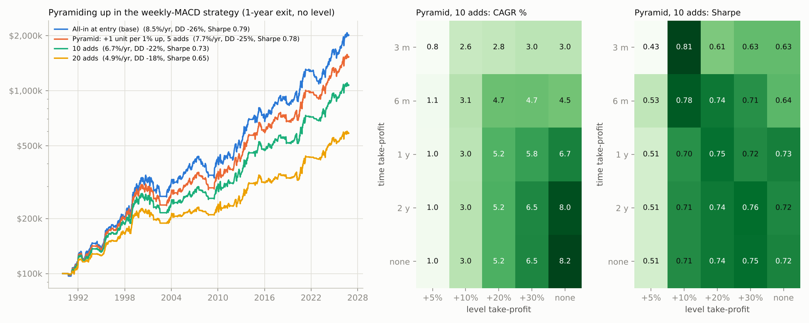

**What to take from it**

1. **Pyramiding up does not improve the strategy.** Every add lowers CAGR and Sharpe: 0.79 → 0.78 → 0.73 → 0.65 for 0 / 5 / 10 / 20 adds. A small pyramid (3-5 adds) is about the same as the base; a large one is clearly worse.
2. **Why:**
   * It does cut the failed trades: the average MACD-stop loss falls from −4.4 % to −3.2 % with 10 adds.
   * But it cuts the winners more, from +26 % to +20 % on 1-year exits, because the extra units are bought higher.
   * And when a strong trend finally rolls over, the position is fully loaded at the top before the weekly MACD stop fires. That makes the worst campaign *worse* (−17 % vs −13 %).
   * Return per dollar invested is unchanged (about 12.3 % for every variant), so pyramiding is just a slower way of getting in.
3. **Take-profit:** the pattern is the same as before. A long hold (2 years / none) with no target gives the most return (8.0-8.2 % with 10 adds). The best Sharpe cells (0.81 at 3 months / +10 %) only invest 8-16 % of the money, so they earn 1-3 %/yr. You would need leverage to make them useful, and leveraged they end up no better than the base.
4. **Bottom line:** keep buying the full position at the signal. If you want a gentler ramp-in, 3 adds of 1 % costs almost nothing (8.1 % vs 8.5 % CAGR, same Sharpe).

Reproduce: `python scripts/macd_pyramid_study.py && python scripts/macd_pyramid_charts.py`.

---

## (First reading of the MACD idea) DeMark 9 only in an uptrend: weekly MACD filter, MACD stop, 1-year exit, max 3 assets

Rules (`scripts/macd_study.py`, results in `results/macd/`):

* **Signal:** a TD buy setup 9, taken **only if the weekly MACD line (EMA12 − EMA26) and its signal line (EMA9 of MACD) are both above 0**. Both are read at the last completed week.
  * Run as a weekly-9 book and as a daily-9 book. Both use the *weekly* MACD.
* **Entry** at the next open. **Stop-loss:** the first weekly close with the MACD line below 0, exit at the next open. **Take-profit:** exit after **1 year** in the position.
* **Max 3 assets at once.** Each new position gets 1/3 of current equity, with compounding and no leverage. Ties go to the deepest sell-off; 3 bps per side.

| Compounded, 1990-2026 | Trades | Win % | Avg trade | Exit at 1 year (avg) | Exit on MACD < 0 (avg) | CAGR | Max DD | Sharpe | Time invested |
|---|---|---|---|---|---|---|---|---|---|
| **Weekly 9 + MACD filter** | 38 | 37 % | +3.3 % | 18 % of trades (+24.1 %) | 74 % (−1.9 %) | 1.1 % | −7 % | 0.42 | 9 % |
| **Daily 9 + MACD filter** | 195 | 38 % | +3.2 % | 22 % (+26.6 %) | 77 % (−3.4 %) | **4.7 %** | **−35 %** | 0.43 | 72 % |
| Daily, stop on the *signal* line < 0 instead | 152 | 47 % | +5.2 % | 34 % (+24.0 %) | 64 % (−4.6 %) | 6.2 % | −33 % | 0.54 | 77 % |
| Daily, MACD stop, hold up to 2 years | 146 | 41 % | +7.3 % | 8 % (+59 %) | 90 % (+2.6 %) | 7.8 % | −39 % | 0.60 | 78 % |
| Daily, MACD filter, no stop (1 year only) | 97 | 67 % | +5.6 % | 97 % | – | 4.1 % | −50 % | 0.35 | 86 % |
| Daily, same rules on *random* filtered days (30 draws) | – | – | +5.6 % | – | – | 6.4 % (5.1–7.5) | −38 % | 0.55 (0.46–0.65) | – |
| Equal-weight buy & hold of all 27 | – | – | – | – | – | **9.7 %** | −52 % | **0.68** | 100 % |
| S&P 500 buy & hold (price) | – | – | – | – | – | 8.6 % | −57 % | 0.55 | 100 % |

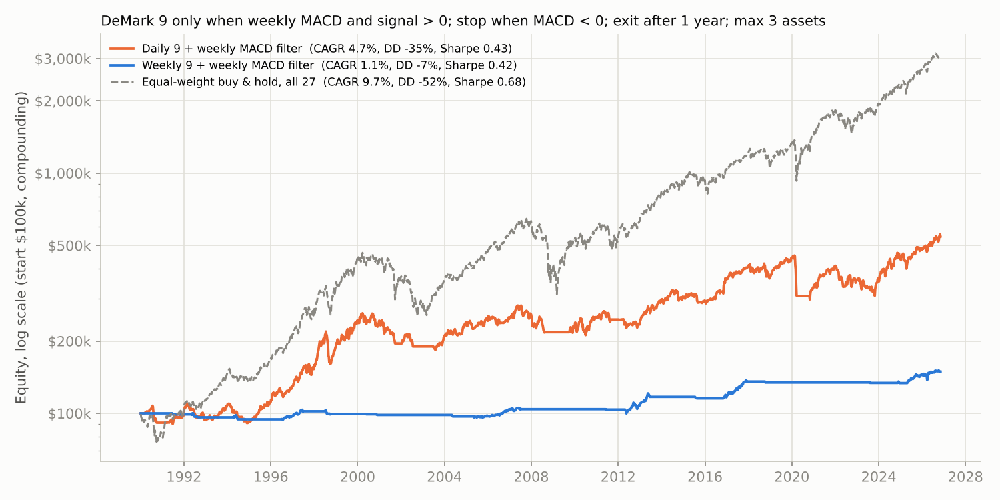

**What to take from it**

1. **Weekly 9 plus a positive weekly MACD almost never happens.** Nine weeks of lower closes usually push the weekly MACD below zero. That left 38 trades in 36 years, with the money in the market only 9 % of the time. The result is a safe (−7 % max DD) but nearly idle 1.1 %/yr. As a weekly strategy this filter mostly switches the 9 off.
2. **Daily 9 plus a positive weekly MACD is a trend-following profile.** You lose small on most trades: 77 % are stopped at about −3 %. You win big on the 22 % that make it to the 1-year exit (about +27 %). The result is a 4.7 % CAGR with a −35 % max DD. The worst losses come from fast crashes, which the weekly MACD reacts to too late: COVID in March 2020 cost −27 % on XLF and −26 % on AEX within 2 weeks, and 2001 cost −20 %.
3. **The 9 does not add value inside this filter.** Entering on random days that pass the same MACD > 0 test, with the same stop, exit and 3 slots, gives a better 6.4 % CAGR and 0.55 Sharpe. The real 9 lands below the random 5th percentile. In an uptrend, a 9-day pullback is more often the start of a trend break than a dip worth buying.
4. **The stop and exit are better looser.** Exiting on the signal line < 0 (slower than the MACD line) gives 6.2 % CAGR and Sharpe 0.54. Holding winners 2 years instead of 1 gives 7.8 % CAGR and Sharpe 0.60. Both hold up in-sample and out-of-sample: 5.7 → 7.1 % and 7.9 → 7.5 % CAGR. Max 1 asset is too concentrated (−60 % DD), and max 5 is no better than 3.
5. **None of the versions beats simply holding the 27 instruments** (9.7 % CAGR, Sharpe 0.68). What this rule set gives you is a smaller drawdown (−33 % to −39 % vs −52 %) for less return. With the MACD filter on, the best-scoring choices are the loosest: signal-line stop and 2-year hold.

**Live under the asked rules** (latest close 2026-11-03):
* **Weekly book:**
  * Holding: S&P 500 (9 of 2026-04-02, entered at 6,587.66, now +14.9 %, exit by 2027-04-06), Russell 2000 and FTSE MIB (entered 2026-11-02).
  * IBEX 35 and Euro Stoxx 50 had filtered 9s the same week but no free slot.
* **Daily book:**
  * Holding: SMI (+15.4 %, exit by 2027-03-13), XLE Energy (+21.5 %, exit by 2027-04-15) and Dow 30 (+0.7 %, exit by 2027-10-06).
  * Russell 2000, Nasdaq 100 and XLK had filtered 9s in late October but no free slot.

Reproduce: `python scripts/macd_study.py && python scripts/macd_charts.py`.

---

## Averaging-down grid with no stop-loss, exit at a 30 % retracement, max 3 assets

Rules (`scripts/grid_study.py`, results in `results/grid/`):

* **Target T:** the sell-off low + **30 %** × (old high − low). This is the 30 % retracement of the drop.
  * Old high = highest high of the 52 weeks (weekly) or 63 days (daily) before the 9.
  * Low = lowest low between that high and the 9.
  * 26-week and 252-day highs, and a 50 % retracement, were also tested.
* **Grid:** a level every **1 %** below T (2 % also tested). Hold *n* units: the next sell is 1 % higher and the next buy 1 % lower.
* **No stop-loss.** Each 1 % fall buys 1 unit. Each 1 % rise sells 1 unit, the last one bought.
* **Starting size:** at the 9 (next open) buy *j₀* units, where *j₀* is the number of 1 % steps from the entry up to T. Selling one unit per 1 % up-step then reaches **0 exactly at the 30 % retracement**, where the campaign ends. On average weekly starts with 5.6 units and daily with 2.2.
* **Unit:** 1 % of capital ($1,000 notional on $100k, fixed, no compounding). Costs are 3 bps per fill.
* **Max 3 assets at once.** First come, first served; same-day ties go to the deepest sell-off. A new 9 on an asset already in a campaign is ignored.

| Unit = 1 % of capital, step 1 %, 30 % retracement | Weekly 9 (52-week high) | Daily 9 (63-day high) |
|---|---|---|
| Campaigns 1990-2026 | 96 | 284 |
| Reached the 30 % retracement (position 0) | **99 %**. Every completed campaign is profitable. | **99 %** (98 % of them profitable) |
| Median / longest campaign | 14 days / **15.5 years** (FTSE MIB 2008 → 2024) | 6 days / **33 years** (Nikkei 1990 → 2023) |
| Most units held in one campaign | 140 (XLK Nov 2000 → Jul 2014) | 148 (Nikkei) |
| Worst open (unrealised) loss in one campaign | **−$48.6k** (XLK 2002) | **−$43.7k** (Nikkei) |
| Peak long exposure | 1.8× capital | 1.9× capital |
| PnL per year (% of capital) | 4.7 % | 5.0 % |
| **Max drawdown** | **−70 %** (Jan 2001 → Oct 2002) | **−85 %** (Oct 2007 → Mar 2009) |
| Sharpe | 0.31 | 0.28 |
| Unit size for a 25 % max drawdown → PnL/yr | $358 → 1.7 %/yr | $296 → 1.5 %/yr |
| Open now | Hang Seng (9 of 2026-10-23): 5 units from 23,157, target 24,179 | CAC 40 (target 8,535), ASX 200 (9,029), XLC (106.52) |

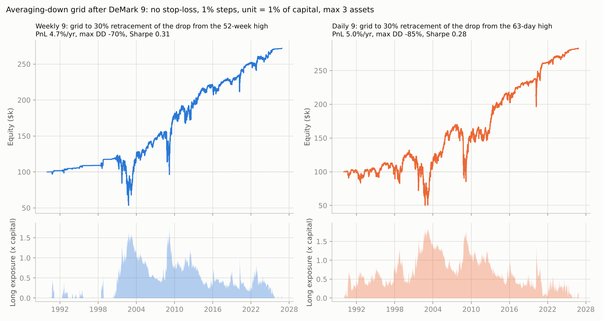

**What to take from it**

1. **It almost never loses a campaign, and that is the catch.** 99 % of campaigns end at the 30 % retracement in profit. But a few campaigns in long bear markets sit underwater for 10–30 years while the position keeps growing (Nasdaq 2001 → 2012, XLK 2000 → 2014, FTSE MIB 2008 → 2024, Nikkei 1990 → 2023). They eventually close in profit, and they are where most of the PnL comes from. Along the way the account falls 70–85 % and uses up to 1.9× leverage.
2. **The 3-asset cap does not protect you.** In 2000-02 and 2008 the three slots fill with the first three sell-offs and stay stuck for years. There is no stop, so nothing frees them.
3. **A wider step is better.** 2 % steps hold half the units for the same campaign, which roughly halves the drawdown (weekly −32 %, daily −40 %) and lifts Sharpe to 0.34–0.36. A 50 % retracement makes slightly more but campaigns last longer and drawdowns are deeper.
4. **Risk-adjusted it is the weakest design so far.**
   * This grid: Sharpe 0.28–0.36.
   * Earlier time-stop designs: Sharpe 0.55–0.79.
   * Equal-weight buy & hold: Sharpe 0.68.
   * At the same 25 % max drawdown, this grid makes about 1.5–1.7 %/yr. The weekly 1,2,3-sizing time-stop design makes about 4.8 %/yr and daily 1 re-entry at 2× about 4.2 %/yr.
5. **If you still want to run it:**
   * Use 2 % steps and a unit of no more than 0.35–0.6 % of capital, which keeps the historical drawdown near 25 %.
   * Accept that a campaign can tie up a slot for a decade.
   * The grid only works if you can keep adding while down 50 %+, so check margin and funding.

Reproduce: `python scripts/grid_study.py && python scripts/grid_charts.py`.

---

## Martingale until the old high (no time stop)

The question: keep going in above the 9-candle high and out below its low, making each new attempt bigger, until price gets back to the **old high**. Near the old high the position goes to 0 and the campaign ends. Rules as simulated:

* **Old high:** the pre-sell-off peak, i.e. the highest high of the 52 weeks (weekly) or 63 days (daily) before the 9. These lookbacks and the exit distance were picked in-sample. Tested alternatives were 26 weeks / 252 days, and exiting 0, 0.25, 0.5 or 1 ATR below the high.
* **Exit:** weekly exits exactly at the old high; daily exits 1 ATR below it.
* **No time stop and no re-entry window.** A campaign ends only at the old high, or as a loss when the allowed re-entries are used up.
* **New 9 on the same instrument while flat:** the campaign carries on and in/out moves to the new 9-candle. The size step and the old-high target stay the same.
  * The other two options were tested and fail. Keeping the old candle forever let a single campaign wait for decades and block the slot: only 4 weekly campaigns in 36 years. Ending the campaign on a new 9 resets the martingale, so earlier losses are never won back.
* One campaign at a time, the same $100k account, 0.5 % base risk, notional capped at 2× capital per position.

| One campaign at a time | Campaigns | Reached old high | Ran out of re-entries | Avg length | PnL / yr | Max DD | Sharpe | Worst campaign |
|---|---|---|---|---|---|---|---|---|
| **Weekly ×2 martingale, 5 re-entries** | 16 | 75 % | 19 % | 723 days (max 8.2 yrs) | 2.7 % | **−97 %** | 0.12 | **−$45.9k** (XLF 2007-09) |
| Weekly ×2 martingale, 10 re-entries | 8 | 62 % | 25 % | 1,589 days | 0.6 % | **account wiped out (2009)** | 0.02 | −$84.0k (Nikkei 1990-95) |
| Weekly linear 1,2,3…, 5 re-entries | 16 | 75 % | 19 % | 723 days | 1.9 % | −26 % | 0.27 | −$15.4k |
| Weekly flat size, 5 re-entries | 16 | 75 % | 19 % | 723 days | 1.6 % | −14 % | 0.39 | −$4.1k |
| **Daily ×2 martingale, 5 re-entries** | 103 | 93 % | 6 % | 111 days (max 2.7 yrs) | **6.5 %** | **−42 %** | 0.41 | **−$26.9k** (Hang Seng 2021-22) |
| Daily ×2 martingale, 10 re-entries | 38 | 92 % | 5 % | 335 days | 9.7 % | **−148 % (wiped out)** | 0.23 | −$87.1k (Nikkei 1990-98) |
| Daily linear, 5 re-entries | 103 | 93 % | 6 % | 111 days | 2.3 % | −24 % | 0.37 | −$11.6k |
| Daily flat size, 5 re-entries | 103 | 93 % | 6 % | 111 days | 0.9 % | −7 % | 0.45 | −$3.5k |
| *For comparison: previous one-campaign design, daily 1 re-entry 2×, time stop* | 288 | – | – | ~1 month | 1.9 % | −11 % | **0.65** | −$1.9k |
| *For comparison: previous weekly linear, ~26-week time stop* | 43 | – | – | ~6 months | 2.9 % | −15 % | **0.55** | −$3.6k |

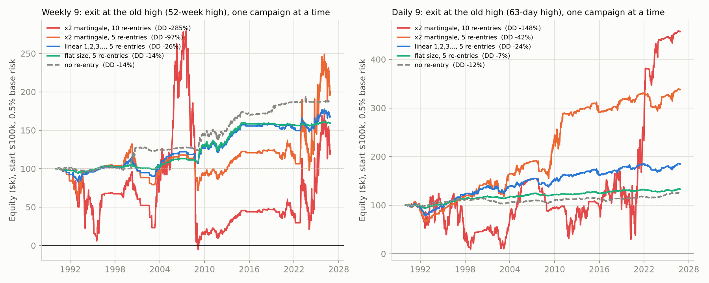

**What to take from it**

1. **The martingale feels great and fails badly.** 75 % (weekly) to 93 % (daily) of campaigns do get back to the old high. The rest are catastrophic: −92R in one weekly campaign (XLF, Aug 2007 → Jan 2009), and −54R daily (Hang Seng 2021-22). With 10 re-entries the account is wiped out on both timeframes (Nikkei 1990s, FTSE MIB 2008). These failures are the crash years.
2. **On weekly, "no stopping" locks the only slot for years.** The average campaign lasts 2 years. The Hang Seng campaign from the 9 of 2018-08-03 is **still open after 8 years**. Its 6th attempt is at 31× size (2× notional cap), entered at 15,994 with a stop at 14,770, and its target is the 2018 high of 33,484. Meanwhile every other weekly 9 since 2018 has been skipped.
3. **Daily works better than weekly with this exit**, because the 63-day high is close and campaigns resolve in about 4 months. The ×2 martingale makes 6.5 %/yr but with a −42 % drawdown and Sharpe 0.41. Scaled down to the same −11 % drawdown, it would make about 1.7 %/yr, less than the previous time-stop design (1.9 %/yr at Sharpe 0.65).
4. **If you want to run to the old high, keep the size flat.** Flat sizing gives the same 93 % / 75 % hit rate with a worst campaign of −7R (daily) and −8R (weekly). On daily the drawdown is −7 % at Sharpe 0.45. The higher win rate comes from the re-entries and the far target, not from increasing the size.
5. **Bottom line:** the earlier design is better than martingale-to-the-old-high on every risk-adjusted measure here: re-enter once (daily) or with 1,2,3 sizing (weekly), and exit on a time stop.

**Live under this rule** (latest close 2026-11-03, one campaign per book):
* **Weekly:** Hang Seng, as described in point 2. Last close 23,526.
* **Daily:** Hang Seng, 9 from 2026-07-02, first attempt (1×), entered at 23,554, stop 22,735.6, exit at 26,408.6. Last close 23,526.

Files: `results/oldhigh/` (grid of all 2,304 variants, campaigns, trades and equity per variant, summary.json). Reproduce with `python scripts/oldhigh_study.py && python scripts/oldhigh_charts.py`.

---

## Rule: only ONE DeMark-9 campaign at a time

A **campaign** starts at its first fill and lasts until its final exit, re-entries included. While a campaign is live, **no other 9 is played**, whichever instrument it comes from. A 9 whose first fill falls inside a live campaign is skipped completely.
* A 9 that is armed but never fills blocks nothing.
* If several 9s fill on the same day, the one with the **deepest sell-off** (largest drawdown from its 52-week or 252-day high) takes the slot.
* Weekly and daily are run as two separate books, each limited to one campaign.

Results are in `results/one_campaign/`. Reproduce with `MODE=one`, as shown in the Reproduce section.

| Same account: $100k, 0.5 % base risk, no compounding | Weekly 9, 5 re-entries ×2 | Weekly 9, 5 re-entries linear (1,2,3…) | Weekly 9, no re-entry | **Daily 9, 1 re-entry ×2** | Daily 9, 5 re-entries linear | Daily 9, no re-entry |
|---|---|---|---|---|---|---|
| Campaigns (1990–2026) | 43 | 43 | 92 | 288 | 283 | 377 |
| Campaign win rate | 53.5 % | 53.5 % | 22.8 % | 53.1 % | 53.7 % | 43.2 % |
| Avg PnL per campaign | **+5.94 R** | +4.88 R | +0.97 R | +0.49 R | +0.46 R | +0.21 R |
| Profit factor, in-sample → out-of-sample | 6.25 → **6.11** | 6.18 → 4.20 | 2.69 → 1.47 | 1.85 → 1.66 | 1.64 → 1.69 | 1.31 → 1.49 |
| Total PnL | +$128k | ≈ +$105k | +$45k | +$71k | +$65k | +$39k |
| PnL per year, % of capital | 3.5 % | 2.9 % | 1.2 % | 1.9 % | 1.8 % | 1.1 % |
| Max drawdown (daily mark-to-market) | −24.2 % | **−14.9 %** | −10.9 % | **−11.4 %** | −12.0 % | −17.8 % |
| Sharpe | 0.49 | **0.55** | 0.27 | **0.65** | 0.57 | 0.47 |
| Worst campaign | −$4.3k | −$3.6k | −$1.3k | −$1.9k | −$7.0k | −$1.1k |
| Max gross exposure | 2.3× | 1.8× | 1.7× | 1.0× | 1.0× | 0.7× |

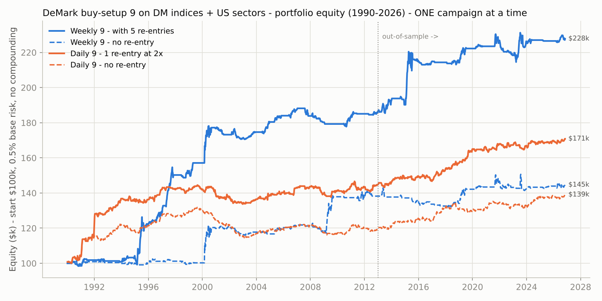

**What changes with one campaign at a time**

1. **Risk falls sharply.** The same weekly ×2 martingale goes from a −72 % to a **−24 %** max drawdown, and from 6.9× to 2.3× peak leverage. Daily goes from −43 % to **−11 %**. There is never more than one instrument's risk on the book.
2. **Profit falls too.** Only about 1.2 weekly campaigns (each ~6 months long) or ~8 daily campaigns fit per year, and average exposure is just 0.1–0.2×. So 0.5 % base risk is now very conservative. Everything scales linearly with base risk. For a ~20 % max drawdown you can risk about **0.67 %** on weekly-linear (≈3.8 %/yr) or **0.88 %** on daily one-re-entry (≈3.4 %/yr). Running **one weekly and one daily book together** gives 5.4 %/yr, −25.7 % max DD and Sharpe 0.67 at 0.5 % base risk, because the two books' daily PnL correlation is only 0.13.
3. **Re-entries matter even more now.** With one slot, a failed first attempt would otherwise waste months of capacity.
   * **Weekly:** the first attempt wins only 16 % of the time (+1.0R), but **re-entry #1 wins 46 % (+1.6R)**. With re-entries, average PnL per campaign rises from +0.97R to +5.9R and stays stable out-of-sample (PF 6.1).
   * **Daily:** re-entry #1 wins 60 % (+0.67R) vs 41 % (+0.18R) on the first attempt.
   * In practice weekly never needs more than 3 re-entries, and daily needs 1. Daily re-entry #2 loses money (−0.49R, 8 cases).
4. **Best sizing under this rule:**
   * **Weekly: linear (1, 2, 3…).** It has the best Sharpe (0.55) and return per unit of drawdown (0.19). ×2 makes ~20 % more profit but with 60 % more drawdown.
   * **Daily: one re-entry at 2×.**
5. **Which 9 gets the slot matters a lot on weekly.** Picking the **deepest** sell-off when several fire together gives +5.9R per campaign (PF 6.2). Picking the **shallowest** gives +2.4R (PF 1.7) with a 4× bigger drawdown. A random pick gives a median of +5.2R (PF 3.5, 90 % band 2.2–7.6). With only 43 campaigns, luck in which signal you take is a big part of the result. On daily the pick barely matters (0.41–0.46R).
6. **Don't re-optimize the rules under this constraint.** There are too few campaigns.
   * A full re-optimization picks a 40-day weekly hold (in-sample PF 4.4 → out-of-sample 2.6). On daily it picks perfected setups with a TDST target and falls from PF 1.84 to **1.05** out-of-sample.
   * The rules chosen on the many-campaign sample (6–7× more trades) hold up: weekly PF 6.25 → 6.11, daily 1.85 → 1.66. They are used above, and only the size scheme was chosen under the rule.
7. **The edge vs random gets harder to prove.** With so few trades, the TD9 results now fall inside the random-entry 90 % band on both timeframes:
   * weekly +5.9R vs random 0.5–7.7R
   * daily +0.46R vs random 0.20–0.50R

**Live state under this rule** (latest close 2026-11-03):
* **Weekly book:** the active campaign is **XLI (Industrials)**. Its 9 came on 2026-10-16. The first attempt was stopped, and re-entry #1 (2×) filled at 170.06 with a stop at 164.66. It took the slot after the XLF campaign (2026-03-16 → 2026-10-13) ended. The later weekly 9s are **skipped** under this rule: Euro Stoxx 50, IBEX, FTSE MIB, Russell 2000, CAC 40, Hang Seng, XLU and XLRE.
* **Daily book:** no campaign is live. Armed buy-stops are Nasdaq 100 (29,936.29), IBEX (19,149.94, new 9 on 2026-11-03) and XLC (104.72). The first one to fill takes the slot. Full table: `results/one_campaign/live_sequences_{W,D}.csv`.

---

## Earlier version: many campaigns at once (one per instrument)

### TL;DR for the many-campaigns version

| | Weekly 9, 5 re-entries (geo ×2) | Weekly 9, no re-entry | Daily 9, 5 re-entries (linear) | **Daily 9, 1 re-entry ×2 (recommended)** | Equal-weight buy & hold |
|---|---|---|---|---|---|
| Sequences (signals traded) | 319 | 321 | 1,605 | 1,605 | – |
| Sequence win rate | 55.8 % | 29.0 % | 55.1 % | 54.7 % | – |
| Avg PnL per sequence | **+3.11 R** | +1.04 R | +0.43 R | +0.42 R | – |
| Profit factor (sequences) | 3.12 | 2.46 | 1.72 | 1.73 | – |
| **Total PnL on $100k** (0.5 % base risk, no compounding) | **+$496k** | +$167k | +$343k | +$340k | – |
| PnL per year, % of capital | 13.5 % | 4.6 % | 9.3 % | 9.2 % | 9.7 % CAGR |
| **Max drawdown, % of capital** | **−72 %** | −30 % | −51 % | −43 % | −52 % |
| Sharpe (daily MTM) | 0.59 | 0.51 | 0.76 (OOS 1.04) | **0.79** | 0.68 |
| Worst single sequence | **−$20.0k** | −$1.3k | −$7.0k | −$2.2k | – |
| Max gross exposure | 6.9× | 3.1× | 4.5× | 4.5× | 1× |

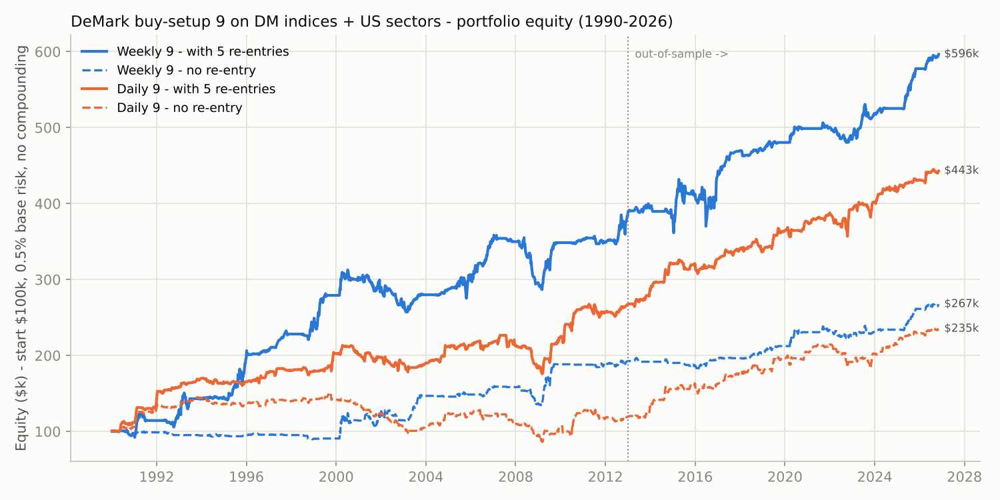

**What to take away**

1. **Weekly 9 is a "buy the sell-off and hold" trade, not a quick bounce trade.** The best weekly rules use **no profit target**, a **~26-week time stop**, entry at the **next open** after the 9, and the stop **exactly at the 9-candle low** (no buffer). Tight targets (1–2R) destroy the edge because rebounds after a weekly 9 run for months. The median R/year across the whole grid falls in this order: no target > TDST > 3R > 2R > 1.5R > 1R.
2. **Daily 9 is a short-term trade, and the edge sits in the first re-entry.** On its own the first daily attempt barely breaks even (+0.17R, no better than random). **Re-entry #1** (price takes out the 9-candle high + 0.5 ATR after a stop-out) earns **+0.70R with a 59 % win rate**. Re-entries #2–#5 almost never trigger (20 times in 36 years with a 20-day window), so on daily, **"5 re-entries" in practice means "1 re-entry at 2×"**.
3. **Bigger size on re-entries mostly just adds leverage.** On weekly, re-entries keep a similar edge to the first attempt (+0.9R, +0.7R, +1.1R… per unit of own risk), so a geometric size-up raises profit, but drawdown rises almost one for one (risk-adjusted return MAR goes from 0.15 to 0.19). The ×2 martingale can lose **20 % of capital in one sequence** and needs up to **6.9× gross exposure**. If you want to size up, use a **linear** progression (1, 2, 3…) or **×1.5**, not ×2.
4. **Is DeMark itself the edge? A placebo test.** The placebo runs the same rules on random bars from the same instruments and the same sell-off state:
   * **Daily:** real TD9 hold-20d gives **+1.03 %** vs **+0.69 %** random (90 % band 0.56–0.85). The full design earns **0.43R** vs **0.31R** random (band 0.23–0.39). **The daily TD9 has a real short-term edge.**
   * **Weekly:** real TD9 hold-26w gives **+5.9 %** vs **+4.4 %** random (band 3.0–5.9), right at the top of the random band. With the re-entry rules, real **3.11R** vs random **3.42R**. **Most of the weekly profit is long-equity drift plus position sizing, not timing.**
5. **Deeper sell-offs are worse, not better.** Requiring the 9 to come with a ≥10–15 % drawdown lowers results on both timeframes. Deep drawdowns are bear markets (2001-02, 2008), where 9s fail one after another. **The max drawdown bottoms in March 2009 in every variant**, so 2008 dominates the risk.
6. **Filters that don't help:** a *perfected* setup (worse), a buy-stop entry on weekly (worse; the weekly high is too far away), and stop buffers on weekly (worse).
7. **The main risk is correlation.** The 27 instruments sell off together, so a crash triggers many 9s at once. Capping open sequences (2/3/5/8) lowers drawdown but lowers PnL proportionally, so MAR does not improve. **The cheapest risk control is a smaller base risk.** Everything scales linearly. For a ~25 % max drawdown, use ≈0.17 % base risk on the weekly ×2 design, ≈0.29 % on daily 1× re-entry, or ≈0.42 % on weekly with no re-entry.
8. **Robustness:** the weekly parameter ranking is stable in-sample vs out-of-sample (rank correlation 0.67 across 90,720 configs). The daily ranking is not (0.13), so don't over-tune daily parameters. The chosen daily config still did better out-of-sample (Sharpe 1.04).

---

## Strategy rules (as simulated)

**Signal: TD buy setup 9.** It needs 9 consecutive closes below the close 4 bars earlier, after a bearish price flip. Bar 9 is the *signal candle*. The signal is known at bar 9's close; for weekly that is the last trading day of the week.

**Per signal ("sequence"):**

| Element | Rule | Optimized over |
|---|---|---|
| Initial entry | `next_open` (buy next session's open) or `break_high` (buy-stop above the candle high) | both |
| Stop-loss | candle low − buf × ATR(14) of the signal timeframe; the same stop for every attempt | buf ∈ {0, 0.1, 0.25, 0.5} |
| Re-entry trigger | candle high + buf × ATR (buy-stop) after a stop-out | ↑ |
| Re-entries | up to *m* re-entries | m ∈ {0…5} |
| Size of attempt k | base risk × w_k, with w = flat (1,1,1,…), linear (1,2,3,…), ×1.5, ×2 | 4 schemes |
| Profit exit | target at 1/1.5/2/3 R, TDST (highest high of the setup), or none | 6 options |
| Time exit | close after N days in the trade | weekly 40/65/130 d, daily 5/10/20 d |
| Re-entry window | re-entries allowed only within N days of the signal | weekly 20/65/130 d, daily 5/10/20 d |
| Sell-off filter | drawdown at the 9 vs the 52-week (weekly) or 252-day (daily) max close | weekly 0–20 %, daily 0–15 % |
| Perfected filter | low of bar 8 or 9 ≤ lows of bars 6 and 7 | on/off |

A sequence ends when one of these happens:
* a winning or time exit
* all allowed attempts are used up
* the re-entry window expires while flat
* a newer 9 on the same instrument appears while flat

Each instrument has one sequence at a time.

**Execution realism**
* Weekly signals are also **executed on daily bars**. Each day's path is O→H→L→C or O→L→H→C, whichever extreme is nearer the open is visited first. Stops and buy-stops that gap through fill at the open.
* Costs are **3 bps per side** on notional.
* Size is fixed from the *planned* entry, so a gap fill costs extra R.
* A stop is never sized tighter than 0.1 ATR.
* Notional is capped at **2× capital per position**. This cap binds for the large martingale attempts on daily.

**Account:** $100k, base risk 0.5 % ($500) on the first attempt. Risk is a fixed dollar amount (no compounding), and any number of instruments may be open at once. PnL is FX-neutral: each index is traded like a USD-quanto future.

**Optimization:** 4,320 path configs × 21 (re-entries × sizing) = 90,720 configs per timeframe. Configs are selected by **in-sample MAR** (R per year ÷ max drawdown in R) with at least 60 weekly or 250 daily sequences, then checked out-of-sample.

## Universe

* **DM indices (16):** S&P 500, Nasdaq 100, Dow 30, Russell 2000, S&P/TSX, Euro Stoxx 50, DAX, FTSE 100, CAC 40, AEX, IBEX 35, SMI, FTSE MIB, Nikkei 225, ASX 200, Hang Seng
* **US sectors (11):** SPDR sector ETFs XLK, XLF, XLE, XLV, XLI, XLY, XLP, XLU, XLB, XLRE, XLC (dividend-adjusted)

Each series starts at its first date with real OHLC candles. Before that, Yahoo has close-only data for some indices (DAX before 1994, FTSE MIB before 2004, ASX before 2001).

## Detailed results

### The value of each re-entry (avg R in units of that attempt's *own* risk)

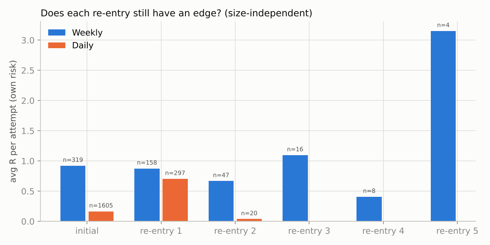

| Attempt | Weekly n | Weekly win % | Weekly avg R | Daily n | Daily win % | Daily avg R |
|---|---|---|---|---|---|---|
| initial | 319 | 28.8 | +0.92 | 1,605 | 45.2 | +0.17 |
| re-entry 1 | 158 | 41.1 | +0.88 | 297 | **58.9** | **+0.70** |
| re-entry 2 | 47 | 34.0 | +0.67 | 20 | 50.0 | +0.04 |
| re-entry 3 | 16 | 37.5 | +1.10 | 0 | – | – |
| re-entry 4 | 8 | 37.5 | +0.41 | 0 | – | – |
| re-entry 5 | 4 | 50.0 | +3.15 | 0 | – | – |

Weekly re-entries 3–5 rest on very few cases (16/8/4), so don't rely on those numbers.

### Re-entries × size scheme: return vs drawdown

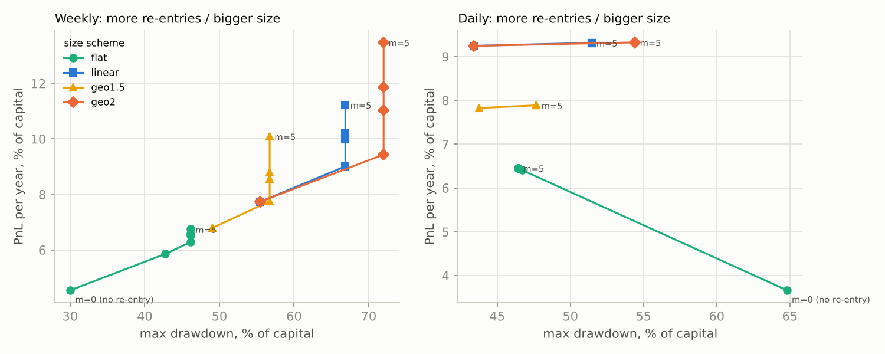

Full tables are in `results/risk_table_W.csv` and `results/risk_table_D.csv`.

### Best weekly configs, in-sample → out-of-sample (R per year)

| Config | IS R/yr | IS MAR | OOS R/yr | OOS MAR |
|---|---|---|---|---|
| next_open, buf 0, no target, 130 d, m=4 ×2, perfected only | 19.3 | 0.20 | 14.8 | 0.11 |
| same, all 9s | 25.8 | 0.19 | 20.3 | 0.15 |
| same, all 9s, m=5 ×2 (design) | 25.2 | 0.19 | 29.8 | 0.26 |

More rows are in `results/top25_IS_W.csv` and `results/top25_IS_D.csv`.

### PnL by instrument (weekly design)

Every instrument except ASX 200, IBEX 35 and Euro Stoxx 50 is profitable. The best are Nikkei (+$75k), Russell 2000, CAC 40, Nasdaq 100 and Dow 30. DM indices made +$368k and US sectors +$129k. Daily per-instrument PnL is in `results/summary.json`.

## Live state (as of the 2026-11-03 close; weekly as of the week ending 2026-10-30)

Running the same engine on today's data gives the following model states. They are for research and are not investment advice.

**Weekly design** (stop = 9-candle low, re-entry = 9-candle high):

| Instrument | Weekly 9 on | Stop | Re-entry trigger | State |
|---|---|---|---|---|
| Russell 2000 | 2026-10-30 | 2,778.17 | 2,868.37 | in position (attempt 1, 1×) |
| Euro Stoxx 50 | 2026-10-30 | 6,061.50 | 6,222.72 | in position (1×) |
| IBEX 35 | 2026-10-30 | 18,643.70 | 19,187.40 | in position (1×) |
| FTSE MIB | 2026-10-30 | 48,674 | 50,145 | in position (1×) |
| CAC 40 | 2026-10-23 | 7,728.45 | 7,926.38 | in position (1×) |
| Hang Seng | 2026-10-23 | 22,803.77 | 24,139.11 | in position (1×) |
| XLI Industrials | 2026-10-16 | 164.66 | 170.06 | in position (**re-entry 1, 2×**) |
| XLU Utilities | 2026-09-25 | 39.13 | 40.93 | in position (**re-entry 1, 2×**) |
| XLRE Real Estate | 2026-10-09 | 40.28 | 41.69 | in position (1×) |

This is a cluster of weekly 9s across Europe, small caps and Hong Kong. Historically, clusters like this are both the best rebounds (2009, 2003) and the worst losses (2008), so keep the **total** risk in mind. The daily states (armed buy-stops on Nasdaq 100 and XLC, Hang Seng and XLK waiting for a 2× re-entry, a new IBEX daily 9) are in `results/live_sequences_D.csv`.

## Files

```
strategy/
  universe.py   instruments + clean start dates
  data.py       Yahoo download/cache, weekly candles
  demark.py     TD buy setup count, setup-9 signals, perfection, TDST, ATR
  engine.py     per-signal state machine: entry, stop, re-entry, target/time exit (daily path)
  backtest.py   signal prep, path runs, sequence selection (per instrument / one campaign at a time),
                sizing, metrics, MTM equity, placebo
  fastagg.py    vectorized aggregation used by the optimizer
scripts/
  optimize.py      grid search  -> results/grid_{W,D}.csv.gz (not committed, ~3.5 min)
  run_backtest.py  picks configs (in-sample), detail runs, placebo, risk tables, live state
  make_charts.py   PNG charts
  oldhigh_study.py martingale-until-the-old-high study (no time stop) -> results/oldhigh/
  oldhigh_charts.py its equity chart
  grid_study.py    averaging-down grid, no stop, exit at 30 % retracement, max 3 assets -> results/grid/
  grid_charts.py   its chart
  macd_study.py    DeMark 9 with weekly MACD > 0 filter, MACD < 0 stop, 1-year exit, max 3 assets -> results/macd/
  macd_charts.py   its chart
  macd_only_study.py  weekly MACD as the only signal, MACD < 0 stop, 1-year exit, max 3 assets -> results/macd_only/
  macd_only_charts.py its chart
  macd_variants_study.py  1 % stop + re-entry, 1 % ladder / martingale, take-profit grid -> results/macd_variants/
  macd_variants_charts.py its chart
  macd_pyramid_study.py   pyramiding up (+1 unit every 1 % up) -> results/macd_pyramid/
  macd_pyramid_charts.py  its chart
  us100_universe.py / us100_data.py / us100_study.py / us100_charts.py
                   the same MACD tests on the 100 biggest US stocks -> data/us100/, results/us100/
  sp500_pit_data.py / sp500_pit_fix.py / sp500_pit_study.py
                   point-in-time S&P 500 top 100 (less survivorship bias) -> data/sp500_pit/, results/sp500_pit/
  macd_short_study.py  short leg on DM indices (MACD < 0), combined long/short -> results/macd_short/
  pit_short_charts.py  charts for both
  worst_short_study.py / worst_short_charts.py
                   short leg on the worst weekly-MACD profile of the 27, contrarian test, overlays -> results/worst_short/
strategy/grid.py   the grid engine (levels, LIFO units, starting size j0)
strategy/macd_engine.py  campaign engine for the MACD strategy (base / 1 % stop + re-entry / ladder / pyramid, time + level TP)
tests/test_engine.py
results/        many-campaigns run: summary.json, equity_*.csv, trades_*.csv, risk/concurrency tables, live state, charts
results/one_campaign/   the same outputs under the one-campaign-at-a-time rule (+ priority_*.csv tie-break test)
```

## Reproduce

```bash
pip install -r requirements.txt
```

```bash
python scripts/optimize.py both
```

```bash
MODE=one python scripts/optimize.py both
```

```bash
python scripts/run_backtest.py && python scripts/make_charts.py
```

```bash
MODE=one python scripts/run_backtest.py && MODE=one python scripts/make_charts.py
```

```bash
python -m pytest -q tests
```

Set `DATA_CUTOFF=YYYY-MM-DD` to drop bars on or after a date. The default drops 2026-11-04, the session that was still forming.

## Caveats

* The indices are price indices without dividends, and they are not directly tradable. Futures and ETFs have roll costs, financing and tracking differences. Costs are modeled flat at 3 bps per side.
* Intraday order of high and low is a heuristic. Same-day stop and re-entry fills are approximations.
* Results are on a fixed $ risk with no compounding and no portfolio-level risk cap. Leverage reaches 4–7× gross in clusters.
* The best configs sit at the edge of the grid: no target, the longest time stop, the longest window. On weekly this shows the edge comes from holding long equities. Extending the grid further would mostly add more beta.
* The universe has survivorship-free index levels but is concentrated in correlated developed markets.
